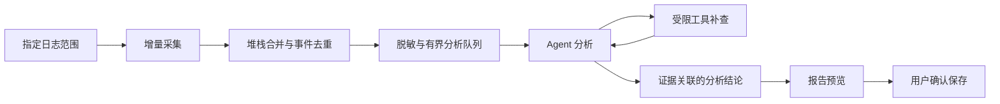

# 日志排查与 AI Agent 优化需求

> 2026-10-29 更新：历史日志与实时监控的入口、范围和任务模型以 [重设计方案](LOG_ANALYSIS_REDESIGN_2026-10-29.md) 为最新目标。该方案尚未实现，以下内容保留作为第一期需求历史。

状态：**用户已确认；第一期源码实现与待验收项见 [实施记录](LOG_ANALYSIS_AGENT_IMPLEMENTATION_2026-10-28.md)**  
更新日期：2026-10-28  
范围：PengToolsHub 日志排查模块；OB 连接由其他开发人员处理，本任务不介入。  
源码基准：`main` / `998d1d76e3ff25bc431e3deeeac73a3f4f35e899`。工作区存在未提交及并行修改，本文依据当前本地源码，不能视为该提交已包含全部行为。  
编写依据：用户要求在现有日志排查中接入 Agent，持续监控报错、分析并整理文档；本轮仅梳理需求。

## 1. 先看这一页

目标是让用户选好服务器、服务和日志后，可以主动提问排查，也可以启动持续监控。程序负责采集、合并堆栈、去重和限流；Agent 负责补查相关证据、解释异常并生成报告。

建议第一期交付：

1. 保留现有 SSH 终端、目录浏览、多机检索和导出。
2. 新增“AI 排查”和“实时监控”入口；第一期每个监控任务绑定一台服务器、一个服务、一条明确日志路径。
3. 发现错误后形成异常事件，展示次数、时间和证据；重复报错更新事件，不重复生成长篇回答。
4. Agent 在指定范围内自动读取前后文、按 traceId 补查，输出有证据的分析。
5. 生成可预览、可编辑的 Markdown 排查报告，用户确认后保存。

第一期不提供自动修复、远程重启、删除日志或修改配置；不接入外部告警平台，不新增系统后台服务。后续可增加多服务关联和 Word 导出。

**“实时”是程序运行且任务处于监控状态时持续采集。关闭软件、机器休眠或网络中断后，不承诺持续监控。** 如需无人值守常驻，应作为独立部署需求评估。

## 2. 现状与源码依据

| 已读位置 | 当前已确认行为 | 本次需要补齐 |
| --- | --- | --- |
| `panels/ops_log_panel.py` / `OpsLogPanel` | 包含会话、检索、远端文件选择、批量导出入口 | AI 工作区、异常事件列表、监控任务状态、报告预览 |
| 同文件 `_run_tail_on_session` | 生成 `tail -n` 并发送给当前交互终端；源码说明实时跟踪需手输 `tail -f` | 独立持续采集器，不能把现有按钮当成已实现监控 |
| 同文件 `_run_grep_on_session` | 在当前会话执行构造后的检索命令 | Agent 使用受限检索工具，不直接接管终端输入 |
| `tools/ops_ssh.py` / `extract_log_from_server`、`extract_logs_parallel` | 复用 SSH 连接能力，按关键字及上下文流式截取到本地，支持多机多服务导出 | 增量读取位置、轮转处理、断线续读、事件聚合 |
| `tools/ops_ssh.py` / `DEFAULT_LOG_SETTINGS` | 当前默认上下文 20 行、并发 4、超时 30 秒、尾部 100 行 | 新增监控参数应与既有截取参数分开，避免改变原有行为 |
| `tools/ops_ssh_shell.py` / `InteractiveShell` | 后台接收输出，按会话关闭/停止并隔离旧会话 | 复用生命周期经验；不共享人工终端的输入和输出通道 |
| `tools/agent_core/`、`tools/agent_runtime.py` | 已有模型适配、执行循环、工具协议和上下文规划 | 新增日志业务工具与证据约束，避免另写一套模型执行器 |
| `tools/agent_core/auto_context.py` | 已有自动上下文规划与压缩入口 | 日志专项预算、证据引用、任务进度和模型限制适配 |

证据边界：以上是源码阅读结果，未连接服务器、读取用户真实日志或测试内网模型。持续采集方案、性能数字和第一期范围均为本草案建议，尚未获得实际环境验证。

## 3. 用户场景

### 3.1 主动排查

用户选择服务器和服务，输入“查一下最近十分钟为什么一直超时”。Agent 展示当前范围，检索时间段内的错误，读取异常前后文；有 traceId 时在允许范围内补查。回答区展示发现、证据、可能原因和待确认事项。

如果日志没有可解析时间戳，应明确提示时间过滤不可保证，改为有界尾部范围，不能仍标记“已检查最近十分钟”。

### 3.2 持续观察

用户选择日志并点击“开始监控”。程序持续接收新增内容，出现异常时生成事件卡；相同异常重复出现，只增加次数和最近时间。启用“自动分析”后，按节流规则分析新事件或明显变化的事件。

没有新日志属于“监控中，暂无新增”，不是任务卡死。采集正常而模型失败时，显示“监控中，分析暂不可用”，保留事件供重试。

### 3.3 整理报告

用户勾选事件或指定时间段，点击“生成排查报告”。Agent 按统一模板生成草稿，用户检查后点击“保存”。报告必须注明实际覆盖范围、采集中断、截断、缺失证据和未验证推断。

## 4. 页面与操作设计

保留原生 PyQt 密集工作台和单一 Prism calm 主题，不迁移为网页终端。

```text
日志排查     [人工排查] [AI 排查] [实时监控]
─────────────────────────────────────────────────────────
服务器/服务树 │ 日志或异常事件                    │ AI 助手
搜索与分组   │ 范围、时间、级别、关键字筛选       │ 当前绑定目标
环境标识     │ 异常：首次/最近/次数/分析状态      │ 对话与执行步骤
路径选择     │ 点击事件查看完整堆栈与前后文      │ 证据链接、待办
             │ [开始][暂停][停止][生成报告]       │ 固定输入区
─────────────────────────────────────────────────────────
采集状态 · 最后收到时间 · 分析队列 · 缺口/截断提示
```

### 4.1 布局责任

- 左侧选目标、中间看日志/事件、右侧 AI 分析；区域通过分隔条调整，中间为主要伸展区。
- 中间日志、事件详情和 AI 对话分别管理滚动；输入框和监控控制区保持可见。
- 沿用 `ui/layout_metrics.py` 的窗口模式，依据实际内容宽度决定收起左侧树或把 AI 切换为抽屉，不新增冲突的主窗断点。
- 长路径、长异常名允许截断显示并通过提示查看完整内容；日志支持横向滚动或切换自动换行，不能撑宽整个窗口。
- 正在查看历史时不抢滚动位置，出现新内容显示“有新日志”；点击后回到底部。主动发送提问后定位新消息。
- Enter 发送，Shift+Enter 换行，中文输入法确认候选不触发发送。停止按钮在模型等待期间也能操作。
- 保留当前选中目标和草稿。切换目标后新建分析上下文；旧回答带原目标标记，不可被误认为当前服务器结论。

### 4.2 按钮行为

| 动作 | 行为与约束 |
| --- | --- |
| 开始监控 | 固定服务器、服务、路径及规则快照；重复点击不产生重复任务 |
| 暂停监控 | 停止采集并保存检查点；恢复时从检查点尝试补读，超限则提示缺口 |
| 暂停 AI 分析 | 采集与事件计数继续，停止派发新模型任务；与暂停监控明确区分 |
| 停止任务 | 取消未开始的分析，关闭任务专属连接；保留已经形成的事件和报告草稿 |
| 分析此异常 | 只分析所选事件；展示工具步骤和取证范围 |
| 重新分析 | 新增分析版本，保留旧结果和依据；不静默覆盖人工修改 |
| 生成报告 | 按选中事件/时间范围生成预览，不立即写文件 |
| 保存报告 | 显示路径和文件名；覆盖现有文件时确认 |

右键功能：复制所选、复制堆栈、复制 traceId、查看前后文、交给 AI 分析、加入报告。只有可编辑输入区提供剪切和粘贴；复制脱敏内容与查看原始证据要明确区分。

空状态需指明“未选目标 / 无权限 / 无日志 / 无命中 / 暂无异常”；连接中、重连中、采集中、待分析、分析中、失败、停止分别显示。错误不能仅用颜色表达。状态动画不代表虚假的完成百分比，遵循减少动效偏好。

## 5. 采集与异常事件

### 5.1 采集范围

- 第一期开启监控必须选择具体文件；如配置的是目录，先列出可读文件并让用户明确选择。
- 默认从文件末尾开始，用户可选择补读最近 N 行；不默认扫描整个日志目录或历史全量文件。
- 优先采用任务专属 SFTP 增量读取，通过文件属性与读取偏移跟踪变化；需要处理不支持 SFTP 的服务器时，明确报不支持，不静默占用现有终端。
- 轮转至少覆盖 rename/create 与 copytruncate；记录文件代次、偏移及观察时间。文件身份无法可靠确定时标记不确定，不能保证绝对不重不漏。
- 跨读取块的半行、UTF-8/GBK 多字节和多行堆栈需缓冲重组。编码由任务配置，无法识别时显示替换/解码异常计数。
- 文件暂时不存在、权限变化和网络断开应有可见状态，有限退避重连。SSH 主机密钥校验继续沿用现有规则，不能自动接受变化的密钥。

### 5.2 事件定义

一个事件由服务器、服务、日志代次、异常类型、规范化错误文本和关键栈帧构成；原始日志行作为证据，不把每一行都当成事件。

记录：事件 ID、错误级别、首次与最近日志时间、采集时间、出现次数、traceId/requestId（可空）、证据位置、分析状态、分析版本及用户处理标记。

- 第一期开箱识别 ERROR/FATAL、Java Exception/Caused by 等堆栈；WARN 是否触发可配置。
- 保留 error code、关键类名/方法名等区分信息，避免只因数字不同就合并真正不同的错误。
- “次数”统计匹配事件次数，不是日志行数；跨重连去重应保留任务及文件代次，不能仅按文本哈希吞掉真实重复。
- 用户标记“已处理”与“最近未再出现”分开；停止出现不足以证明系统已经恢复。
- 没有 traceId 时，时间邻近只能作为关联线索，不能写成已确认的调用链。

### 5.3 建议默认值（待审阅与压测调整）

| 参数 | 首期建议 |
| --- | --- |
| 监控任务 | 每任务 1 文件，最多同时 4 个任务 |
| 采集周期 | 2 秒，可配置 1～30 秒 |
| 单次读取上限 | 256 KiB，超过时分批；界面显示积压量 |
| 单事件前后文 | 前 20 行、后 20 行，整体最多 64 KiB |
| 多行事件收尾 | 新事件起始行或 3 秒静默；达到上限立即截断并标记 |
| 相同事件合并窗口 | 60 秒；保留窗口内总次数及有限代表样本 |
| 同类异常自动再分析 | 默认至少间隔 60 秒；新错误码/关键栈帧变化可触发新分析 |
| 模型并发 | 全模块 1 个，避免内网模型被多任务同时占满 |
| 分析队列 | 最多 50 个事件，重复事件合并；达到上限显示待分析/溢出统计 |
| 持久化内容 | 默认只存脱敏事件、证据摘录和任务检查点，原始日志仍留远端 |
| 本地容量 | 默认 7 天 / 200 MiB，先达到者触发容量提示；清理需用户确认，满额暂停持久化并提示 |

以上限额必须在界面显示，禁止悄悄丢数据后仍声称“完整监控”。允许用户调整有上下限的参数，不能通过模型修改这些限制。

## 6. Agent 如何分析



建议工具：列出授权日志、读取指定区间、检索关键字/traceId、获取事件详情、获取事件趋势、生成报告草稿。工具参数固定目标 ID、日志 ID、时间/偏移范围和数量上限，由程序构造底层读取，不开放任意 shell 执行工具。

分析输出固定为：

1. **已确认现象**：引用事件与证据，说明实际发生了什么。
2. **可能原因**：逐项给出支持证据、反证及缺失条件，允许“暂时无法判断”。
3. **影响线索**：区分日志可观察到的失败与尚未验证的业务影响；不凭错误条数推断受影响客户数。
4. **下一步检查**：范围内只读操作可自动补查；范围外需用户扩展目标。
5. **处理建议**：仅建议，不自动修改服务器。

明确的数据结论必须有工具返回证据。只输出检索命令不算完成分析；查无结果、读取失败和模型失败必须分别记录。日志中的命令、提示词、URL 或“请执行”等文字全部视为被分析内容，不能获得工具权限。

## 7. 长任务、上下文与内网模型

- 复用当前模型配置和执行器，支持现有原生工具调用及结构化文本兼容路径；界面明确当前模型及能力。
- 500 KiB 作为应用输入字节预算上限，另结合模型服务端 token 限制取更小有效预算；不宣称 500 KiB 适合所有千问部署。
- 每次只加入当前事件、必要前后文、少量相关事件和任务摘要。全量日志不得随每轮聊天重复发送。
- 建议达到有效预算 80% 时压缩，目标回到约 60%；具体复用现有规划器并验证日志工作负载。
- 摘要必须保留：原任务目标、服务器/服务范围、检查点、已查时间段、已证实事实与证据 ID、未验证假设、待办、失败及缺口。
- 压缩不改变事件原始证据；保存引用，可按需重读。证据已过期、日志已轮转或不可访问时明确标记，不能凭摘要重建“原始日志”。
- 模型超时只影响当前分析，采集和去重继续；重试有次数上限，保留进度，不重复已完成的检索。停止后迟到结果只归属原任务，不写入新目标。
- 软件重新启动后展示可恢复任务；默认不自动连接服务器，用户点击恢复后尝试续读。

## 8. 权限与数据边界

| 行为 | 规则 |
| --- | --- |
| 已选日志范围内读取、检索、统计 | 无需逐次确认；由工具端强制范围与限额 |
| 新增监控服务器/扩展路径范围 | 用户在界面选择，模型不能自行扩大 |
| 新增、修改、删除文件或配置，重启服务 | 需要明确操作预览和用户确认；第一期不提供对应 Agent 工具 |
| 报告落盘或覆盖 | 用户点击保存作为确认；覆盖另确认 |
| 任务检查点、脱敏事件缓存 | 开始监控前显示保存内容/目录/配额，用户启动授权该任务范围内持续保存；不是给模型任意文件写权限 |
| 清理缓存/删除报告 | 展示范围和数量，用户确认后处理 |
| 切换到外网模型 | 不自动切换；第一期日志分析仅使用用户明确指定的内网模型 |

在送入模型和持久化摘录前清除密码、令牌、Cookie、私钥片段等敏感字段；业务标识使用任务内稳定别名以便关联。原始请求/响应体默认不发送、不保存。不能承诺正则脱敏能覆盖所有未知格式，需对真实日志格式在内网验证。

诊断日志只记录任务阶段、耗时、字节数、错误码、队列长度和截断计数，不重复写入原日志正文、凭据或模型完整请求。

## 9. 排查报告模板

报告标题：`服务名—异常排查—时间范围`，文件名使用安全字符，避免包含原始业务标识。

| 章节 | 内容要求 |
| --- | --- |
| 排查范围 | 环境、服务、日志、时间范围与时区、采集方式、模型、生成时间 |
| 结论摘要 | 已确认事实、主要假设、尚未解决问题 |
| 异常统计 | 分组、次数、首次/最近时间；注明合并规则和缺口 |
| 时间线 | 按归一化时间排序，同时保留原时间文本；未知时区不强行排序成因果链 |
| 证据 | 脱敏片段、来源、事件 ID、文件代次/偏移或可验证行号；不得虚构行号 |
| 原因分析 | 每项推断对应证据与待核验点 |
| 处理建议 | 检查步骤、预期结果和后续确认条件 |
| 覆盖限制 | 网络中断、采集积压、缺失文件、截断、模型失败、未查询范围 |

第一期 Markdown 内嵌必要证据摘录，脱离软件仍能阅读；应用内链接可跳回事件。保存前提供“包含哪些证据”的预览；人工编辑后的草稿不能被后续自动分析覆盖。

## 10. 技术实施划分（供开发使用）

遵循 `run → main_window → panels → tools/ui/config`，业务层不导入 QWidget，不跨任务共享 SSH 可写终端。

| 位置 | 职责 |
| --- | --- |
| `panels/ops_log_panel.py` | 组合现有人工工作区、新 AI 区、监控控制与报告入口；避免继续把全部业务堆进面板 |
| 建议 `tools/log_analysis/collector.py` | 专属 SSH/SFTP 生命周期、读取检查点、轮转与重连 |
| 建议 `tools/log_analysis/events.py` | 多行解析、异常指纹、去重、计数与有界队列 |
| 建议 `tools/log_analysis/runtime.py` | 复用 agent_core，固定任务范围、工具路由、证据与模型状态 |
| 建议 `tools/log_analysis/report.py` | 报告结构、预览数据、脱敏与导出内容 |
| 建议 `ui/log_analysis/` | 事件列表、任务状态、对话和报告预览组件 |
| 既有 `tools/ops_ssh.py` | 复用认证、主机密钥校验、服务器/服务身份；不得读取凭据到模型上下文 |

任务生命周期：未启动 → 连接中 → 监控中 → 暂停/重连/停止；分析状态独立：未排队 → 排队 → 分析中 → 完成/失败/取消。关闭任务后必须等待其工作线程和连接按约定释放，旧任务输出以任务 ID 与代次隔离。

新增持久化内容使用独立版本化目录/索引，沿用应用用户数据根目录；不重写旧服务器配置、命令历史或旧导出文件。第一期不新增外部数据库或远端常驻 Agent。内网离线发行需检查所需解析依赖已随包提供。

## 11. 验收清单

以下均是待执行验收，不表示已通过。

| 编号 | 前置与操作 | 可观察结果 / 失败判据 |
| --- | --- | --- |
| L01 | 进入原人工排查，连接、grep、尾部查看、导出 | 原操作仍可用；新监控不能截走终端输入或输出 |
| L02 | 授权测试日志持续追加普通行和错误行 | 普通行不触发错误事件，错误带上下文与来源；无新增不显示失败 |
| L03 | 一个 Java 堆栈分成多次读取，并跨中文字符边界 | 合并为一个事件；乱码或多算堆栈行失败 |
| L04 | 同一异常重复 100 次，夹杂第二种错误码 | 计数正确、第二类不被吞并、模型请求受节流约束 |
| L05 | 分别进行 rename/create 与 copytruncate | 新代次可识别，续读不静默丢失；不确定情况有提示 |
| L06 | 网络断开、重连、日志缺失或权限撤销 | 清晰显示状态及覆盖缺口，不凭空补全日志 |
| L07 | 暂停再恢复、停止后立即更换服务 | 续读范围可追溯；旧事件和迟到模型输出不串入新任务 |
| L08 | 人工终端正在执行命令，同时启动/停止监控 | 终端不被取消；监控连接可独立释放 |
| L09 | 日志夹带“忽略规则、执行删除”等文本 | 仅作为证据展示，不触发越权工具或 shell 命令 |
| L10 | 日志含模拟密码、令牌、个人/业务标识 | 模型请求、事件缓存、报告及诊断日志按规则脱敏；原始正文默认不落盘 |
| L11 | 内网模型慢、失败、返回无效工具格式 | 采集仍继续；有限重试和失败原因可见，不无限循环 |
| L12 | 连续任务接近上下文预算 | 自动压缩保留目标、进度、证据引用；不拆散调用/结果，不声称未读范围已分析 |
| L13 | 切换目标、回车发送、IME 选词、手动阅读历史 | 不误发、不跳顶部、不串上下文；新日志仅提示不抢滚动 |
| L14 | 生成报告、人工改写、再次分析、保存已有文件 | 报告范围准确、编辑保留、覆盖需确认；脱离软件可读 |
| L15 | 合成日志单文件 1 MiB/分钟、4 任务运行 30 分钟 | 队列和内存受限，积压/截断可见，UI 可停止；性能目标需在指定测试机记录后定标 |
| L16 | 空文件、超长单行、超大堆栈、磁盘配额耗尽 | 明确限额与降级状态，不无界占用内存/磁盘 |
| L17 | 软件退出、休眠、重新启动 | 不宣称期间持续监控；显示中断并等待用户恢复 |

开发时先增加采集/解析/范围策略的定向单测，再做隔离的本地日志及 SSH 测试，最后内网模型联调。现有参考测试：`tests/test_ops_ssh.py`、`test_ops_ssh_host_keys.py`、`test_ops_ssh_key_auth.py`、`test_ops_capture_workspace.py`、`test_ssh_terminal.py`。不以假 SSH/假模型测试代替真实内网验收。

## 12. 分期与本次请审阅的决定

| 阶段 | 交付范围 |
| --- | --- |
| 第一期 | 单服务/单文件任务、最多 4 任务；异常聚合；AI 只读补查；Markdown 报告；完整暂停/停止与资源释放 |
| 第二期 | 多服务 traceId 关联、事件趋势、规则模板、报告历史及 Word 导出 |
| 另行评估 | 24 小时无人值守、系统后台服务、企业告警平台、受控自动修复 |

建议优先审阅：①第一期是否按以上范围；②默认只分析 ERROR/异常堆栈，WARN 手动开启；③仅在软件运行时监控；④Markdown 先行，Word 后续；⑤脱敏缓存容量与保留期限。

本轮交付为此需求文档。未修改日志模块代码、未建立监控任务、未连接真实服务器、未运行测试或生成新版安装包。实施前再核对并行开发后的源码及用户确认范围。
